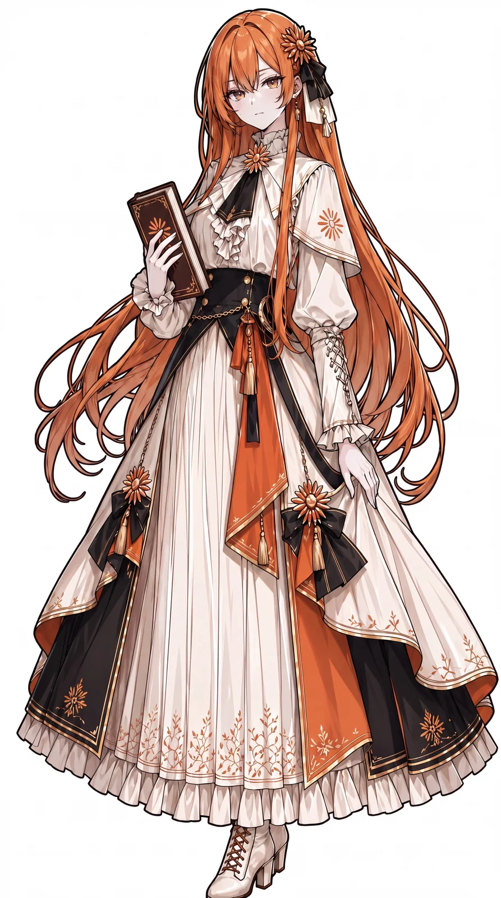

# AI Girl Theme · dsh-ai-girl-theme

An "AI gijinka" theme pack for [DeepSeek Harness](https://github.com/deepseek-ai/deepseek-harness): the conversation backdrop follows the model you are talking to, the whole interface switches to a pixel typeface, and every provider gets its own picture picker in *Settings → Models*.



## Don't want to read this? Paste one prompt into your DSH

Copy the whole block into the chat of the DSH you are running — it installs the theme for you:

```text
Please install the "AI Girl Theme" into the current DSH profile. Install only — do not change any other configuration.

Install spec (pinned version, do not replace it with a branch name):
git+https://github.com/zhouribin/dsh-ai-girl-theme.git#v1.1.0

Steps:
1. Call plugin_manager with action=install_bundle and target=<the spec above>. If it answers already-installed, skip the install instead of duplicating it.
   If install_bundle rejects a git spec, fall back to `dsh plugin --profile <current profile> add '<the spec>'` and add the package name to that profile's dsh.profile.bundles.
2. Read the returned `application` field: only "applied" is success. Read any `warnings` back to me verbatim.
3. Confirm the row with cordis_inspect_query (platform=host, provider=Config, method=listConfigs, name=dsh-ai-girl-theme) — an entry id starting with "include" must appear.
4. The bundle ships a client module, so it only takes effect after the app restarts: remind me to quit and reopen, then refresh the page.
5. Do not touch the DSH installation, the pictures or prefs.json under ~/.dsh/themes, or any other plugin's configuration.

Expected result: a per-model anime backdrop in the conversation, a pixel typeface everywhere, and a "Conversation wallpaper" row in Settings → Models for every provider.
```

Then **restart the app once** (the client half is scanned at boot); after that, changing pictures or configuration only needs a page refresh.

## Manual install

Sidebar **Plugins → Install**, paste:

```
git+https://github.com/zhouribin/dsh-ai-girl-theme.git#v1.1.0
```

Or from a terminal: `dsh plugin --profile <profile> add '<the spec above>'`, then restart the app.

## What it does

- **One backdrop per model**: Claude 娘, GPT 龙娘, Gemini 娘, GLM 娘, Qwen 娘, Kimi 娘, Grok 娘, Hunyuan 娘, Wenxin 娘, MiniMax 娘, Mistral 娘, Llama 娘, Seed 娘, RWKV 娘, DeepSeek 娘 — matched by provider or model id, with a generated aurora fallback.
- **Pixel typeface everywhere**: interface, conversation, code blocks and terminal share one font stack; a face that is not installed is skipped, so the shipped look returns instead of breaking.
- **Per-provider picker**: one row in every provider card, plus a footer row for providers without a card (the signed-in account). Choices persist and outrank the rules.
- **Self-contained and offline**: pictures are served by the plugin from `~/.dsh/themes/images`; nothing inside the DSH installation is modified.

<details>
<summary><b>Customise (pictures, contrast, fonts)</b></summary>

### Pick pictures in the UI

*Settings → Models* → **Conversation wallpaper**. It applies immediately, is written to `~/.dsh/themes/images/prefs.json`, and outranks every rule. Choosing **Default (automatic)** drops the override (the page reloads once).

Replace a picture by overwriting its file in `~/.dsh/themes/images/`; add one by dropping a new file there — it shows up in the picker. Bundled files are only copied when missing, so your versions are never overwritten.

### Rules in the profile patch

`~/.dsh/profiles/<profile>/cordis.patch.yml` — a matching row replaces the pack's whole config:

```yaml
- id: ai-girl-theme
  name: 'dsh-ai-girl-theme'
  config:
    dir: '~/.dsh/themes/images'
    veilDark: 0.4        # surface alpha in the dark palette (1 = opaque, hides the picture)
    veilLight: 0.6
    scrimDark: 0.68      # scrim over the picture (lower = brighter)
    scrimLight: 0.88
    font: true           # false keeps the shipped typeface
    families: ['Zpix']   # extra families tried first
    rules:
      - { provider: 'anthropic*', image: gijinka/claude.webp }
      - { model: 'my-local-model*', image: gijinka/qwen.webp }
      - { provider: 'openai*', model: 'o4*', image: gijinka/gpt.webp, scrimDark: 0.5 }
```

Rules are evaluated in order and the last match wins; a provider or model ending in `*` matches as a prefix, and both may be combined.

### Pixel fonts

The pack ships no font binaries; it uses what the system has (macOS exposes a newly installed font after an app restart):

```sh
brew install --cask font-zpix            # Zpix — Chinese + Latin
brew install --cask font-fusion-pixel    # Fusion Pixel — OFL
brew install --cask font-vt323           # VT323 — Latin only
```

With no pixel font installed the interface simply stays in its shipped typeface.

</details>

<details>
<summary><b>How it works (read this when an update breaks it)</b></summary>

Everything is one `<style>` row on the page bootstrap plus one read-only route — no other plugin's DOM is touched.

| Hook | Used for |
| --- | --- |
| `data-provider-id` / `data-model-id` on the composer's model label, scoped with `:has(button[aria-haspopup="menu"] …)` | Painting the backdrop for the selected model without reacting to the open model menu |
| `--dsw-alias-bg-base`, `data-ds-dark-theme`, `data-ds-theme-source` | Making the frame and conversation column translucent, with separate light/dark values |
| `--dsw-font-family`, `--ds-font-family-code`, `--dsw-font-mono` | The pixel typeface |
| `webserver/index-inject` | The stylesheet and the picker's global (`__DSH_AI_GIRL_THEME__`) |
| `webServer.register('/ai-girl-theme')` | `/index` (picture list), `/prefs` (saved choices), `/<file>` (pictures) |
| `settings.models.provider-card`, `settings.models.footer` | The picker rows |

The picture's pixel size is read from its file header (JPEG SOF, WebP VP8/VP8L/VP8X), so the fade distance follows each picture's own width. If a release renames any name in this table, the matching feature stops silently; the app itself is unaffected — this table is the checklist.

</details>

<details>
<summary><b>Troubleshooting</b></summary>

| Symptom | Likely cause |
| --- | --- |
| Installed but nothing changed | The app was not restarted, so the client module never loaded. Quit and reopen. |
| Picker rows missing | The plugin is disabled in *Plugins*, or `@deepseek-ai/dsh-client-ui-settings-models` is not in this profile. |
| Picture missing for one model | That provider has no rule; pick one in the UI or add a `rules` entry. Unmatched models fall back to the aurora. |
| Picture washed out / too dark | Tune `scrimDark` (main knob) and `veilDark`. |
| Font is not pixel | No pixel font installed, or the app was not restarted after installing one. |
| Everything broke after an app update | See the table above; rename the corresponding identifiers in `index.js` / `client.js`. |

</details>

<details>
<summary><b>Uninstall / layout / licences / compatibility</b></summary>

### Uninstall

Disable or remove the bundle in **Plugins**, then delete `~/.dsh/themes/` if you also want to drop the pictures. Nothing inside the DSH installation was modified.

### Repository layout

```
index.js             Host half: seeding, picture route, stylesheet, bootstrap global
client.js            Client half: picker rows, live apply, saved state
cordis.patch.yml     Default provider/model → picture rules (48)
locale/{en,zh}.json  Bundle title and description for the Plugins list
wallpapers/gijinka/  21 portrait pictures (third-party artwork — see LICENSE-ART.md)
```

### Licence

- **Code**: MIT — see [LICENSE](LICENSE).
- **Artwork**: third-party work by **ZipZipPipe** (the DeepSeek series derives from **上善无形**'s original character), tagged **CC BY-NC-SA 4.0** in the source gallery — attribution required, **non-commercial**, share-alike. Per-file list in [LICENSE-ART.md](LICENSE-ART.md).
- For a fully MIT, freely redistributable plugin, drop the pictures: `git rm -r wallpapers/gijinka` — the pack keeps working and falls back to the generated aurora backgrounds.

Artwork source: [genderswapai.com · AI gijinka gallery](https://genderswapai.com/zh-CN/ai-gijinka/gallery).

### Requirements and compatibility

- DeepSeek Harness **0.2.x** Web / Desktop profile (base-backed profiles ship the plugin manager).
- No npm account, token or registry access: the install spec is a Git URL.
- The Desktop app is on the nightly channel and updates often; the plugin never blocks an app update.
- The internal names it relies on are listed above; if one is renamed, the feature stops silently and the app is unaffected.

</details>
