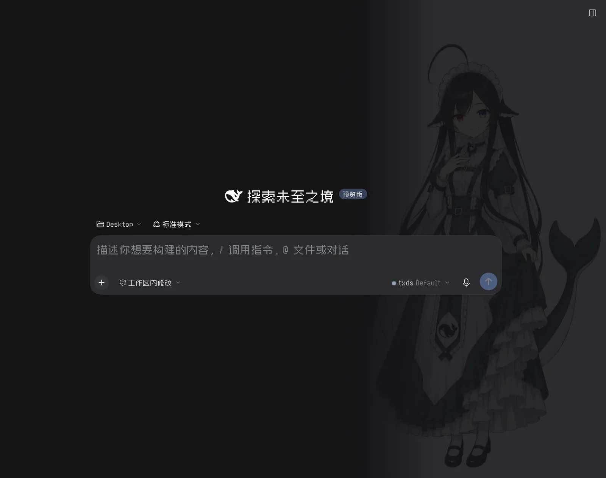

# AI 娘化主题 · dsh-ai-girl-theme

> **English readers → [README.md](README.md)**
>
> 本页是中文说明。

给 [DeepSeek Harness](https://github.com/deepseek-ai/deepseek-harness) 换一套「AI 拟人」外观：**对话区背景跟着模型变**，整个界面换成像素字体，每张 provider 卡片里还能单独挑一张图。



## 不想研究？直接把下面这段丢给你的 DSH

复制整段，粘贴到你正在用的 DSH 对话框里，它自己会装：

```text
请把「AI 娘化主题」装到当前 DSH profile，只安装，不要改其它配置。

安装地址（固定版本，不要换成分支名）：
git+https://github.com/zhouribin/dsh-ai-girl-theme.git#v1.2.1

步骤：
1. 如果当前 DSH 有插件安装入口，用上面的地址安装；否则在终端执行：
   dsh plugin --profile <当前 profile> add 'git+https://github.com/zhouribin/dsh-ai-girl-theme.git#v1.2.1'
   DSH Desktop 的 profile 通常是 desktop；`dsh --profile desktop --dump-config` 会被 Electron 壳拒绝，但 `plugin add` 可用。
   同版本已装就跳过，不要重复安装。
2. 确认：
   - `dsh plugin --profile <profile> list` 显示 dsh-ai-girl-theme@1.2.1；
   - profile 的 package.json 里 dsh.profile.bundles 含 dsh-ai-girl-theme；
   - 运行中的 GUI 源上 GET /ai-girl-theme/index 返回图片 JSON 列表。
3. 这个包带客户端模块：必须完全退出并重开 App（Desktop 从托盘退出，关窗口不算），再刷新页面。
4. 不要动 DSH 安装目录、~/.dsh/themes 下的图片和 prefs.json，也不要改其它插件配置。

装好后的效果：对话区按模型换二次元立绘、全局像素字体、设置 → 模型里每个 provider 多一行「对话背景」。
```

装完**完全退出并重开 App**（Desktop 要从托盘退出，关窗口不算；客户端模块只在启动时扫描），之后换图改配置只需要刷新页面。

## 手动安装（不想用 AI 的话）

侧栏 **「插件」→ 安装**，粘贴：

```
git+https://github.com/zhouribin/dsh-ai-girl-theme.git#v1.2.1
```

或者终端：`dsh plugin --profile <profile> add '<上面那串>'`，然后重启 App。

## 它做了什么

- **一个模型一张背景**：Claude 娘、GPT 龙娘、Gemini 娘、GLM 娘、Qwen 娘、Kimi 娘、Grok 娘、混元娘、文心娘、MiniMax 娘、Mistral 娘、Llama 娘、Seed 娘、RWKV 娘、DeepSeek 娘…… 没匹配到就用内置极光。
- **全局像素字体，字体随包自带**：内置 Fusion Pixel 12px（简体中文 + 拉丁，woff2 约 940KB，OFL 授权），界面、对话、代码块、终端统一换；想优先用系统里的字体，写 `families` 即可，`bundledFont: false` 可以关掉自带字体。
- **每张 provider 卡片可单独选图**：登录账号这种没有卡片的 provider 单独列在底部。选择会记住，优先级高于规则。
- **自带素材、可离线**：图片由插件自己的路由从 `~/.dsh/themes/images` 提供，不联网、不改 DSH 安装目录。

<details>
<summary><b>自定义（选图、调浓淡、换字体）</b></summary>

### 界面里选图

*设置 → 模型* → 「对话背景」→ 选一张。立刻生效，写进 `~/.dsh/themes/images/prefs.json`，优先级高于所有规则。选「默认（自动匹配）」会清掉这条覆盖（会刷新一次页面）。

想换图：直接在 `~/.dsh/themes/images/` 里同名覆盖；想加图：丢新文件进去，下拉里就会多一项（包内原图只在缺失时补，不覆盖你改过的）。

### 用 patch 写规则

`~/.dsh/profiles/<profile>/cordis.patch.yml`——同 id 的行会**整段替换**包里自带的 config：

```yaml
- id: ai-girl-theme
  name: 'dsh-ai-girl-theme'
  config:
    dir: '~/.dsh/themes/images'
    veilDark: 0.4        # 深色下底色不透明度（1 = 完全挡住壁纸）
    veilLight: 0.6
    scrimDark: 0.68      # 盖在图片上的蒙版（越小越亮）
    scrimLight: 0.88
    font: true           # false = 保持官方字体
    families: ['Zpix']   # 优先尝试的字体名
    rules:
      - { provider: 'anthropic*', image: gijinka/claude.webp }
      - { model: 'my-local-model*', image: gijinka/qwen.webp }
      - { provider: 'openai*', model: 'o4*', image: gijinka/gpt.webp, scrimDark: 0.5 }
```

规则按顺序生效，后面的覆盖前面的；`provider` / `model` 结尾写 `*` 表示前缀匹配，两者可同时写。

### 像素字体

包里已经带了 **Fusion Pixel 12px Proportional（简体中文）**，`fonts/` 下是 woff2 + `OFL.txt`（SIL Open Font License 1.1，作者 TakWolf）。所以**装完就有像素字，不需要额外装字体**。

想换成系统里的其它像素字体（比如 Zpix、VT323）：

```yaml
config:
  families: ['Zpix']       # 排在自带字体前面
  # bundledFont: false      # 完全不使用自带字体
```

```sh
brew install --cask font-zpix            # 最像素，中文 + 英文
brew install --cask font-vt323           # VT323，纯英文
```

macOS 上装完系统字体要重启 App 才会被页面识别。

</details>

<details>
<summary><b>工作原理（升级后失效时看这里）</b></summary>

全部实现只有两样东西：**一段注入到页面 bootstrap 的 `<style>`** 和一个只读路由，不碰任何插件的 DOM。

| 依赖的约定 | 用途 |
| --- | --- |
| `sessions.binding(sessionId).session.projections.faceOf('modelSelection')` | 从会话的持久化投影读当前 provider/model——和输入框模型选择器读的是同一个源，所以 composer 卸载后背景仍在 |
| `body[data-ai-girl-provider]` / `body[data-ai-girl-model]` | 宿主样式表实际绘制的稳定锚点；客户端把投影镜像到这两个属性上 |
| `--dsw-alias-bg-base`、`--dsw-specific-sidebar-fill`（Windows 标题栏 frame）、`data-ds-dark-theme`、`data-ds-theme-source` | 让主区和对话列透出背景，浅色/深色各一套 |
| `--dsw-font-family`、`--ds-font-family-code`、`--dsw-font-mono` | 像素字体 |
| `webserver/index-inject` | 注入样式表、`current`（宿主默认选择）和全局变量 `__DSH_AI_GIRL_THEME__` |
| `webServer.register('/ai-girl-theme')` | `/index`（图片列表）、`/prefs`（保存的选择）、`/<file>`（图片） |
| `settings.models.provider-card`、`settings.models.footer` | 选择器所在的两处插槽 |

图片像素尺寸从文件头读（JPEG SOF、WebP 的 VP8/VP8L/VP8X），所以渐隐距离按每张图自己的宽度算。官方某次更新改了上表任意一个名字，对应功能会静默失效，DSH 本体不受影响——按这张表逐项核对即可。

</details>

<details>
<summary><b>常见问题</b></summary>

| 现象 | 原因 |
| --- | --- |
| 装了但没任何变化 | App 没重启，客户端模块没加载。完全退出重开（Desktop 托盘 → 退出）。 |
| 字体生效但背景图不显示 | v1.2.0 把背景锚在 composer 的模型按钮上；生成中或重启进入运行中的会话时按钮不在 DOM。v1.2.1 改为读会话的 `modelSelection` 投影，升级即可。 |
| 背景只闪一下就没（Windows） | 标题栏 frame 用的是不透明的 `--dsw-specific-sidebar-fill`，v1.2.0 只覆盖了 `--dsw-alias-bg-base`，frame 一挂载就盖住 body 背景。v1.2.1 也覆盖 `--dsw-specific-sidebar-fill`，升级即可。 |
| 设置里没有「对话背景」 | 插件在「插件」页被禁用了，或这个 profile 里没有 `@deepseek-ai/dsh-client-ui-settings-models`。 |
| 某个模型没有背景 | 那个 provider 没命中规则；界面里选一张，或补一条 `rules`。没命中时是极光背景。 |
| 图片发白 / 太暗 | 调 `scrimDark`（主开关）和 `veilDark`。 |
| 字体不是像素字 | 自带字体没加载；确认 `/ai-girl-theme/fonts/fusion-pixel-12px-proportional-zh_hans.woff2` 返回 200，再重启。 |
| 客户端更新后全失效 | 见「工作原理」表，改 `index.js` / `client.js` 里对应的名字。 |

</details>

<details>
<summary><b>让别人也能搜到（插件索引）</b></summary>

DSH 没有“提交到官方插件库”的入口；「发现」页读取的是**索引 URL**。本仓库根目录的 `market-index.json` 就是一份格式 1 索引，由 DSH 自带的校验器验证（每次 push 由 GitHub Actions 跑一遍）。

**托管索引**（二选一）：

| 方式 | 索引地址 |
| --- | --- |
| GitHub Pages（推荐） | `https://zhouribin.github.io/dsh-ai-girl-theme/market-index.json` |
| 国内可达的代理 | `https://gh-proxy.com/https://raw.githubusercontent.com/zhouribin/dsh-ai-girl-theme/main/market-index.json` |

Pages 开启方式：仓库 → Settings → Pages → Source 选 `Deploy from a branch` → `main` / `/ (root)` → Save。

**别人怎么装**：

1. 插件 → 添加插件，输入 `@deepseek-ai/dsh-experimental-plugin-market-bundle` 装上并重启 App；
2. 「发现」→ 添加索引 → 填上面的地址；
3. 搜「AI 娘化主题」→ 一键安装。

改版本时记得同步 `market-index.json`（`version`、`source.commit`、`publishTimestamp`），CI 会在版本和 `package.json` 不一致时报红。本地自检：

```sh
npm install --no-save @deepseek-ai/dsh-plugin-market-index@next
node scripts/validate-market-index.mjs
```

</details>

<details>
<summary><b>卸载 / 仓库结构 / 授权 / 兼容性</b></summary>

### 卸载

「插件」里禁用或删除这个 bundle；想连图片一起清掉再删 `~/.dsh/themes/`。DSH 安装目录里的文件没有被改过。

### 仓库结构

```
index.js            Host 端：图片复制、图片路由、样式表、bootstrap 全局变量
client.js           客户端：选择器行、即时生效、保存状态
cordis.patch.yml    默认的 provider/model → 图片规则（48 条）
locale/{en,zh}.json 插件列表里的标题和描述
fonts/              自带像素字体（Fusion Pixel 12px zh_hans，OFL 1.1）
wallpapers/gijinka/ 21 张竖版立绘（第三方作品，见 LICENSE-ART.md）
```

### 授权

- **代码**：MIT，见 [LICENSE](LICENSE)。
- **字体**：`fonts/` 是 Fusion Pixel（作者 TakWolf），**SIL Open Font License 1.1**，许可证原文见 [`fonts/OFL.txt`](fonts/OFL.txt)。
- **图片**：第三方作品，作者 **ZipZipPipe**（DeepSeek 系列为「**上善无形**」原角色二创），图库中标为 **CC BY-NC-SA 4.0**——必须署名、**不能商用**、衍生需同协议。逐文件清单见 [LICENSE-ART.md](LICENSE-ART.md)。
- 想要纯 MIT、可随意分发的版本：`git rm -r wallpapers/gijinka` 后提交，插件仍可用，只是退回内置极光背景。

素材出处：[genderswapai.com · AI 娘化形象图库](https://genderswapai.com/zh-CN/ai-gijinka/gallery)。

### 环境与兼容性

- DeepSeek Harness **0.2.x** 的 Web / Desktop profile。安装不假设一定有内置插件管理工具：`dsh plugin --profile <profile> add '<spec>'` 是受支持的兜底路径。
- DSH Desktop：`plugin add` 对 `desktop` profile 可用；`dsh --profile desktop --dump-config` 会被 Electron 壳拒绝（这是预期行为，不是安装失败）。
- 不需要 npm 账号、token 或 registry：安装地址是 Git URL。
- 桌面端走 nightly，更新频繁；插件不阻塞客户端更新。
- v1.2.1 从会话的 `modelSelection` 投影读当前模型，composer 卸载后背景仍在；v1.2.0 读 composer DOM，生成中可能丢背景。
- 依赖的内部命名见「工作原理」，官方改名后功能静默失效、不影响本体。

</details>
